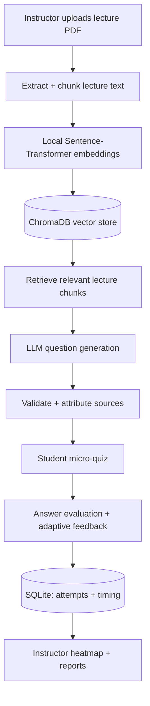
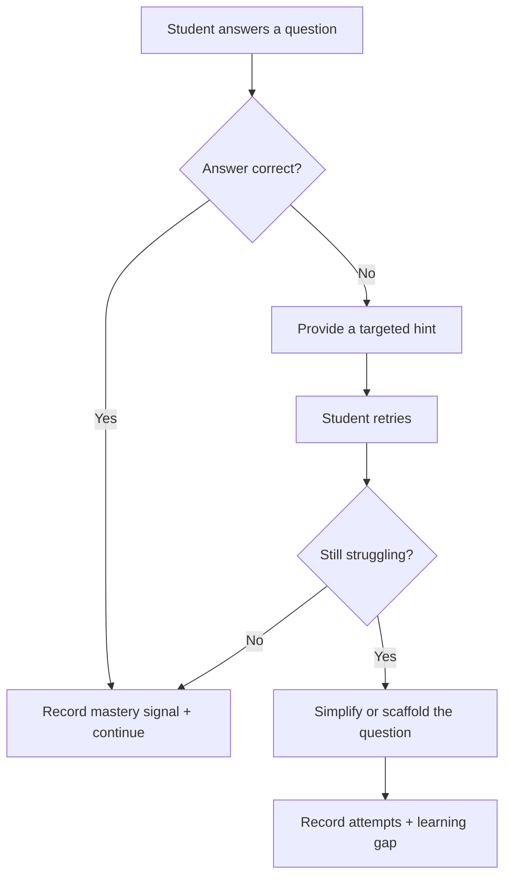
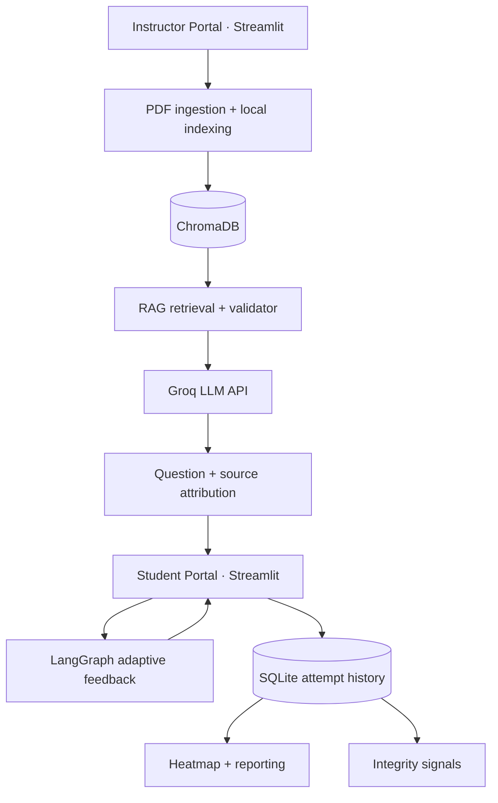

<div align="center">

# 🎓 CodeMentor AI
### Micro-Assessment AI Agent

**From passive exams to continuous, adaptive learning.**

A multi-agent, retrieval-augmented assessment system that turns lecture PDFs into source-grounded micro-quizzes, adapts to student responses, and helps instructors discover knowledge gaps early.

[](#project-overview)
[](#system-architecture)
[](#adaptive-learning-loop)
[](#technology-stack)

**[The idea](#project-overview) · [Features](#key-features) · [Architecture](#system-architecture) · [Quick start](#quick-start) · [Responsible AI](#responsible-ai--privacy)**

[View the GitHub repository](https://github.com/alzoubitoqa/micro-assessment-agent)

</div>

---

## Project overview

### What if instructors could spot confusion *before* the exam?

Traditional assessments often reveal learning gaps only after a midterm or final, when there is little time to intervene.

**CodeMentor AI** brings formative assessment into the learning process itself. An instructor uploads a lecture, the system retrieves relevant course material to generate short questions, and students receive adaptive guidance as they work. Their responses are logged and surfaced in an instructor-facing **Knowledge Gap Heatmap**.

> **The core idea:** Assess in small steps, teach through feedback, and make learning gaps visible while they can still be addressed.

| Conventional assessment | CodeMentor AI approach |
| --- | --- |
| Large, infrequent exams | Short, continuous micro-assessments |
| Mostly static questions | Lecture-grounded question generation |
| Feedback after grading | Hints and adaptive follow-up during practice |
| Difficulty spotting class-wide gaps | Aggregated instructor analytics |
| Limited visibility into question origins | Source chunk attribution and audit traces |

## Key features

| Capability | What it does |
| --- | --- |
| 📄 **Lecture-to-quiz RAG** | Converts uploaded lecture PDFs into retrievable chunks and generates context-aware questions from relevant passages |
| 🧠 **Adaptive learning loop** | Uses LangGraph-driven state transitions to offer hints and simplify follow-up questions when a student struggles |
| ✅ **Validation & attribution** | Checks generated questions against retrieved material and associates them with source chunk IDs |
| 🚨 **Integrity signals** | Highlights unusually fast response patterns for instructor review, without automatically penalizing students |
| 📊 **Knowledge Gap Heatmap** | Helps instructors identify topics that repeatedly cause difficulty across attempts |
| 📈 **Session analytics** | Tracks answers, attempt counts, response-time traces, progress over time, and CSV-ready reporting |
| 🔒 **Local knowledge indexing** | Builds embeddings and stores vectors locally before retrieval |

## How CodeMentor AI works



The system follows a **retrieve → generate → validate → assess → adapt → analyze** workflow.

## Multi-agent intelligence

CodeMentor AI divides assessment work into focused responsibilities rather than relying on one unconstrained prompt.

<details open>
<summary><strong>Explore the agent responsibilities</strong></summary>

| Component / agent role | Responsibility |
| --- | --- |
| **Retrieval (RAG)** | Find lecture chunks relevant to the concept being assessed |
| **Question generation** | Produce a short question using the retrieved course context |
| **Validator** | Review generated content for context support and attach source references |
| **Adaptive tutor** | Select feedback, hints, or a simpler follow-up based on student performance |
| **Integrity / forensics** | Record and flag unusual answer-time patterns as advisory signals |
| **Analytics** | Aggregate attempt history into topic-level insight for instructors |

These are **logical responsibilities** in the application; they do not imply separately deployed services for every agent.

</details>

## Knowledge base & RAG pipeline

The uploaded lecture is the **primary reference**, keeping questions connected to what the instructor actually taught.

### 01 · Ingest

The instructor provides an official lecture PDF through the application.

### 02 · Chunk

`splitter.py` splits extracted text into manageable, context-aware passages.

### 03 · Embed locally

`embedder.py` uses Sentence-Transformers with `all-MiniLM-L6-v2` to create vector embeddings on the local machine.

### 04 · Store & retrieve

ChromaDB persists the vectors, while `retriever.py` performs semantic retrieval to select context for a new question.

### 05 · Generate & validate

The configured LLM creates a candidate question using retrieved course context. The validation layer and source chunk IDs make the result easier to inspect and audit.

> **Grounding reduces risk; it does not guarantee zero hallucinations.** Instructors should review generated questions before using them in consequential evaluations.

## Adaptive learning loop

A wrong answer is treated as a chance to **teach**, not just mark a student down.



LangGraph manages the adaptive routing so feedback can respond to the student's attempts and current state.

## Instructor intelligence

The instructor dashboard aims to make classroom understanding visible at a glance.

- **Knowledge Gap Heatmap:** areas where students repeatedly miss concepts.
- **Attempt history:** retries and question-level outcomes.
- **Response-time analytics:** patterns of unusually quick or slow responses.
- **Session timeline:** changes in performance across assessment activity.
- **CSV reporting:** exportable records for further review.

This is **formative feedback**, not an automatic substitute for instructor judgment.

## Integrity & forensics: advisory, not punitive

The integrity component can flag very short response times, including patterns near a **3-second heuristic threshold**.

A fast answer is **not proof of misconduct**. The signal is intended to draw an instructor's attention to a pattern that may deserve context-aware review, not to generate accusations or automatic penalties.

## System architecture



### Technology stack

| Layer | Technology |
| --- | --- |
| **Instructor & student interfaces** | Streamlit |
| **Agent orchestration** | LangGraph |
| **LLM provider** | Groq API |
| **Configured LLM** | `llama-3.3-70b-versatile` |
| **Local embeddings** | Sentence-Transformers · `all-MiniLM-L6-v2` |
| **Vector store** | ChromaDB |
| **Session / answer records** | SQLite |
| **Language** | Python |

### Key modules

| File | Role |
| --- | --- |
| `dashboard/app.py` | Instructor dashboard entry point |
| `dashboard/student_ui.py` | Student portal entry point |
| `splitter.py` | Lecture chunking |
| `embedder.py` | Local text embeddings |
| `retriever.py` | Semantic retrieval |

*Module paths above follow the supplied project description; adjust any paths that differ in your current repository.*

## Quick start

### Prerequisites

- Python **3.12**
- Git
- A Groq API key
- Internet access for Groq-hosted model requests and initial dependency/model downloads

### 1 · Clone the repository

```bash
git clone https://github.com/alzoubitoqa/micro-assessment-agent.git
cd micro-assessment-agent
```

### 2 · Create a virtual environment

**Windows PowerShell**

```powershell
py -3.12 -m venv .venv
.\.venv\Scripts\Activate.ps1
pip install -r requirements.txt
```

**macOS / Linux**

```bash
python3.12 -m venv .venv
source .venv/bin/activate
pip install -r requirements.txt
```

### 3 · Configure environment variables

Create a `.env` file in the project root:

```dotenv
GROQ_API_KEY=your_groq_api_key_here
LLM_MODEL=llama-3.3-70b-versatile
EMBEDDING_MODEL=all-MiniLM-L6-v2

CHUNK_SIZE=400
CHUNK_OVERLAP=60
TOP_K_RETRIEVAL=5
VALIDATE_QUESTIONS=true
```

Use a model available to your Groq account if the configured model changes.

> [!CAUTION]
> Never commit your real `GROQ_API_KEY`, `.env`, student records, or private lecture materials to GitHub.

### 4 · Start both interfaces

Open **two terminals**, activate the same virtual environment in each, and run:

**Terminal 1 — Instructor dashboard**

```bash
streamlit run dashboard/app.py
```

Default local URL: **http://localhost:8501**

**Terminal 2 — Student portal**

```bash
streamlit run dashboard/student_ui.py --server.port 8502
```

Student URL: **http://localhost:8502**

### 5 · Try the assessment flow

1. Open the instructor dashboard and upload a lecture PDF.
2. Allow the application to process and index the content.
3. Open the student portal and complete a micro-quiz.
4. Try an incorrect answer to explore adaptive feedback.
5. Return to the instructor dashboard to inspect attempts, topic gaps, and analytics.

## Responsible AI & privacy

**Source-grounded, not infallible.** Generated questions use retrieved lecture context and validator checks. Source attribution supports review, but factual correctness still needs human oversight.

**Local indexing, external inference.** The embedding model and vector store run locally. However, **retrieved lecture excerpts may be transmitted to Groq** when the hosted LLM generates or validates content. Do not upload confidential material without appropriate permission and data-handling review.

**Human-in-the-loop integrity.** Response-time alerts are weak indicators by themselves and must not be used as standalone cheating evidence.

**Educational purpose.** CodeMentor AI is designed for practice and formative insight. High-stakes grading requires additional validation, accessibility checks, and institutional safeguards.

## Suggested next milestones

- [ ] Benchmark generated questions for factual accuracy, clarity, and lecture coverage.
- [ ] Measure retrieval quality and validator performance on representative lecture sets.
- [ ] Add instructor approval/editing before quizzes become available to students.
- [ ] Calibrate adaptive feedback with learner studies and accessibility testing.
- [ ] Document student-data retention, access controls, and deployment security.
- [ ] Add screenshots or a short demo of the instructor and student experiences.

---

<div align="center">

### 🎓 CodeMentor AI

**Ask less at once. Understand more over time.**

*Micro-Assessments · Multi-Agent RAG · Adaptive Feedback · Learning Analytics*

Created by **Team إِتْقَان**

</div>

